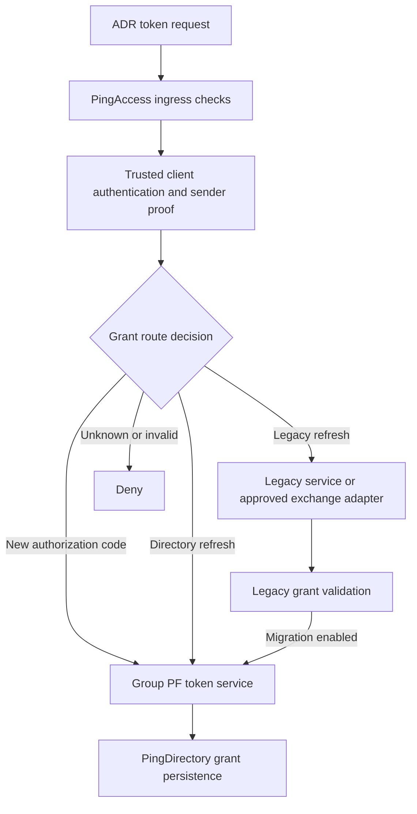

# Organic Open Banking refresh-token migration

## The customer-facing objective

An ADR keeps using the existing published token endpoint. Customers should not have to authorize again solely because the grant store changes. Existing legacy grants continue under their original permissions; new issuances use Group PingFederate with its configured PingDirectory grant store.

This is a reference design and tested routing model, not deployed bank code, a CDR toolkit implementation or a certified Open Banking solution. The legacy grant exchange, product configuration and vendor SDK adapter remain implementation work. No promise of zero customer impact is made without end-to-end testing.

## Forward to token services, not directly to databases

Keep the ADR URL stable and preserve the token POST body. Do not use 302/307 redirects to move credentials or refresh tokens between hosts. A database is a persistence dependency, not an OAuth endpoint. PingAccess must not mint refresh tokens itself or create ad hoc grant LDIF.

## Separate two kinds of authorization

For resource APIs, validate the access token and require the appropriate scope plus active consent. For the token endpoint, authenticate the registered client and its sender proof, then validate the code or refresh grant. Do not require an accounts:read access token merely to refresh a token; do not use an OAuth resource matcher as a substitute for client authentication.

The supplied snippets:
- `pingaccess-rules/accounts-read.groovy`: GET plus accounts:read matcher for a protected resource, after token validation.
- `pingaccess-rules/token-post-only.groovy`: restrict the intended token resource to POST; it performs no authentication.

Both finish with PingAccess matchers. Configure a suitable protocol rejection handler and verify behaviour in the selected product version. Unit tests use mocked bindings and cannot certify deployment.
Source: [PingAccess matchers](https://docs.pingidentity.com/pingaccess/9.1/reference_guides/pa_matcher_usage_ref.html).

## Route decision table

| Request and trusted evidence | Internal target | Expected action |
| --- | --- | --- |
| Authorization-code grant from an enabled client | GROUP_PF_TOKEN | PF validates code, redirect URI, PKCE and consent, then persists the new grant |
| Active legacy refresh; migration off | LEGACY_TOKEN_SERVICE | Continue using the authoritative legacy store |
| Active legacy refresh; migration enabled for the client | LEGACY_EXCHANGE_ADAPTER | Validate old grant and coordinate new issuance |
| Active directory-backed refresh | GROUP_PF_TOKEN | Validate and rotate through the configured grant store |
| Wrong client/certificate, revoked/expired grant or withdrawn consent | No target | Deny |
| Locator/consent dependency down, unknown store or migration pending | No fallback | Fail closed with an appropriate retryable result where applicable |

`src/refresh-migration-router.mjs` returns these logical targets; it is not an HTTP proxy. Its booleans and metadata represent trusted in-process results, never client-provided authentication claims. The HTTP adapter must parse a bounded form body, reject duplicate/conflicting parameters, authenticate the client, validate certificate chain/status and sender binding, and obtain live registration/consent data.

The sender key identifier is a normalized trusted binding handle, not necessarily an immutable certificate thumbprint. Certificate rollover must be validated through registration and binding policy; changing certificates must not silently break or weaken binding.

## How to identify an old token

Do not infer its store from token length, a user-controlled header or whether it looks like a JWT. Maintain a protected authoritative locator keyed by a server-side HMAC of the exact opaque refresh token. Record client, consent, sender binding, expiry, owner store and migration state. Reconcile it with the real grant stores; define a secure index-key rotation process.

The locator is not the final proof of token validity. The selected AS or adapter must revalidate the current grant, consent, client, expiry and replay state at issuance time. Stale metadata cannot authorize a refresh. Avoid lookup enumeration in external error responses.

## Successful migration sequence

1. Authenticate the ADR and verify the legacy refresh against its original authority, not just an index hit. Preserve customer, client, scopes, consent, expiry and sender constraints.
2. Acquire a durable compare-and-set reservation for the legacy token/grant version. Concurrent refresh requests must not create two successor families.
3. Invoke a supported, reviewed exchange/import extension that causes Group PF to issue the new grant and persist it in PingDirectory. A generic token-exchange capability does not automatically accept an arbitrary legacy Cassandra token.
4. Persist the successor mapping and migration outcome durably. Make legacy consumption/revocation part of a recoverable coordinated workflow. Never acknowledge success before required grant/index state is durable.
5. Return the successor token through the same public endpoint and the expected token-response contract. Subsequent requests find the directory-owned token and use Group PF.

Across two stores there is no implicit atomic transaction. Implement a state machine and recovery worker, with fenced ownership, idempotent issuance support or an explicitly designed reconciliation protocol. If the issuer cannot support the required retry semantics, resolve that limitation before rollout. Simply catching an exception and issuing another refresh token is unsafe.

## Timeouts and replay are part of the design

| Failure point | Required behaviour to prove |
| --- | --- |
| Before new issuance | Release/recover reservation according to policy; no successor exists |
| After new issuance but before migration commit | Reconcile the same issuance; do not issue a second family |
| After commit but before ADR receives response | Apply a documented bounded retry/recovery policy compatible with rotation/replay protection |
| Reuse of a consumed legacy token | Reject or trigger the configured family-level replay response; never silently fall back |
| Consent revoked during issuance | Recheck/fence consent so the race cannot grant withdrawn access |

PingFederate's replay response depends on its sessions and persistent-grant settings; test it with the actual rotation policy. Do not add an unlimited old-token grace period for convenience.
Source: [PF grant types](https://docs.pingidentity.com/pingfederate/13.1/introduction_to_pingfederate/pf_grant_types.html).

## PingAccess integration boundary

One straightforward design is a fixed PingAccess site pointing at a hardened migration/token-routing service. That service makes the trusted decision and uses only fixed allowlisted backends. Keep client-authentication responsibilities explicit and preserve mTLS evidence only across an authenticated trusted proxy hop.

A custom PingAccess SDK integration is another option, but no version-specific dynamic site-selection API is invented in this repository. Generic URL rewrite rules do not implement grant lookup or a cross-store transaction. Groovy rules run during request/response processing; a mediated token is not available in Groovy because mediation occurs later.
Sources: [Groovy processing](https://docs.pingidentity.com/pingaccess/9.1/reference_guides/pa_groovy_in_pa.html), [header sanitization](https://docs.pingidentity.com/pingaccess/9.1/reference_guides/pa_headers_object_ref.html).

## Rollout and migration completion

Start with synthetic clients, then an approved canary cohort. Monitor eligible legacy refreshes, completed migrations, replay denials, stuck reservations, store latency and errors using safe reason codes. Do not log raw tokens, assertions, client credentials or customer identifiers as metric labels.

Rollback can stop new migrations, but must keep already-issued directory tokens working. Dormant, revoked or expired grants may never refresh, so organic migration cannot guarantee that every old record migrates. Define an end date, residual-grant policy and customer communication plan. Revalidate discovery, issuer, JWKS, client registrations, PAR, consent APIs, revocation and certificate bindings throughout the transition. Maintain old access-token validation for their remaining valid lifetimes as required by the approved issuer transition.

Run `npm test` for the pure policy models. Live authentication, persistence, concurrency recovery and CDR conformance tests remain required.
